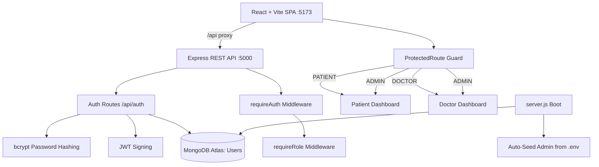

<div align="center">


<h1 align="center">🩺 MedVault AI: Patient–Doctor Records Portal</h1>
<p align="center"><i>Lifelong Medical Records, Verified Doctor Access</i></p>


<br/><br/>

<p align="center">
<b>A centralized healthcare record platform where patients store and manage their medical history for life, and verified doctors get secure emergency access — backed by real authentication and role-based dashboards.</b>
</p>

</div>

<br/>

---

## 

Medical records are scattered across clinics, labs, and paper files — and are hardest to find exactly when they matter most: in an emergency.

**MedVault AI** is a full-stack patient–doctor portal that puts a person's medical history in one place. Patients create an account and manage their own records; doctors sign up, go through a **verification step**, and are then able to access records for emergency care. An auto-seeded **admin** account can open both the Patient and Doctor dashboards.

Login is **real**: accounts live in MongoDB, passwords are hashed with **bcrypt**, and sessions are issued as **JWTs**. Arbitrary email/password combinations no longer work.

<br/>

---

## 

```
                  Create an Account
                          │
            ┌─────────────┴─────────────┐
            ▼                           ▼
        Patient                       Doctor
        Signup                        Signup
            │                           │
            ▼                           ▼
     Active immediately          Status: PENDING
                                  (awaiting verification)
            │                           │
            └─────────────┬─────────────┘
                          ▼
                 Login  →  JWT Session
                          │
        ┌─────────────────┼─────────────────┐
        ▼                 ▼                 ▼
  Patient Dashboard   Doctor Dashboard   Admin
  (own records)       (verified access)  (both dashboards)
```

<br/>

---

## 



<br/>

---

## 

<div align="center">

| Module | Description |
|:--|:--|
| **🔐 Real Authentication** | Signup and login backed by MongoDB, with bcrypt password hashing and JWT sessions. No more accept-anything login. |
| **🧑‍⚕️ Patient Accounts** | Patients sign up and get a personal dashboard for storing and managing lifelong medical records. |
| **👨‍⚕️ Doctor Accounts** | Doctors sign up with credentials and start as `PENDING` until verified, supporting verified emergency access. |
| **🛡️ Role-Based Access** | `requireAuth` and `requireRole` middleware on the API, plus a `ProtectedRoute` guard on the frontend. |
| **👑 Auto-Seeded Admin** | On first start, the backend creates an admin from `ADMIN_EMAIL` / `ADMIN_PASSWORD`. The admin can open **both** dashboards. |
| **🩹 Dashboard Discovery** | `GET /api/auth/dashboards` tells the client which dashboards the signed-in user may open. |
| **📎 Doctor Document Metadata** | Certificates and photos are currently stored as file metadata (name, type, size). Real file storage is a planned next step. |
| **⚡ Dev Proxy** | Vite proxies `/api` to the backend, so the frontend and API share one origin during development. |

</div>

<br/>

---

## 

<div align="center">

| Role | How You Get It | Access |
|:--|:--|:--|
| **Patient** | Create an account via **Create an account → Patient** | Patient dashboard |
| **Doctor** | Create an account via **Create an account → Doctor** (starts as `PENDING` verification) | Doctor dashboard |
| **Admin** | Auto-seeded on first backend start from `backend/.env` | **Both** dashboards |

</div>

<br/>

---

## 

Base URL: `http://localhost:5173/api` (Vite proxies `/api` → `http://localhost:5000`)

<details>
<summary><b>View all endpoints</b></summary>
<br/>

| Method | Endpoint | Auth | Description |
|:--|:--|:--|:--|
| `POST` | `/api/auth/signup/patient` | — | Create a patient account |
| `POST` | `/api/auth/signup/doctor` | — | Create a doctor account (pending verification) |
| `POST` | `/api/auth/login` | — | Login → returns `{ token, user }` |
| `GET` | `/api/auth/me` | JWT | Current user |
| `GET` | `/api/auth/dashboards` | JWT | Dashboards the user may open |
| `GET` | `/api/health` | — | Health check |

**Authentication:** send `Authorization: Bearer <token>`.

</details>

<br/>

---

## 

<div align="center">

| Layer | Technology |
|:--|:--|
| **Frontend** | React, Vite, role-based dashboards, protected routes |
| **Backend** | Node.js 18+, Express REST API |
| **Database** | MongoDB (Atlas, cloud-hosted) |
| **Auth** | bcrypt password hashing, JWT sessions |
| **Dev Tooling** | Vite dev proxy (`/api` → `:5000`) |

</div>

<br/>

---

## 

<details>
<summary><b>View full directory tree</b></summary>
<br/>

```
medvault-ai/
├── backend/
│   ├── models/
│   │   └── User.js                  # User schema + toAuthJSON()
│   ├── routes/
│   │   └── auth.js                  # signup patient/doctor, login, me, dashboards
│   ├── middleware/
│   │   └── auth.js                  # JWT signing, requireAuth, requireRole
│   ├── scripts/
│   │   └── seedAdmin.js             # Re-run admin seeding manually
│   ├── server.js                    # App entry, DB connect + admin seed on boot
│   └── .env                         # Secrets (git-ignored)
└── frontend/
    └── src/
        ├── lib/
        │   ├── api.js               # Fetch wrapper for /api
        │   └── auth.js              # signup/login/session helpers (server-backed)
        ├── components/
        │   └── ProtectedRoute.jsx   # Route guard; ADMIN allowed on both dashboards
        └── pages/
            ├── LoginPage.jsx        # Real login with error toasts
            ├── PatientSignupPage.jsx
            └── DoctorSignupPage.jsx
```

</details>

<br/>

---

## 

**1. Prerequisites**

- **Node.js** 18+ (tested with v24)
- A **MongoDB Atlas** cluster — [create a free one](https://www.mongodb.com/atlas), then go to *Database → Connect → Drivers* and copy your connection string

**2. Install the Backend**

```bash
cd backend
npm install
```

**3. Environment Setup**

Edit `backend/.env`:

```env
# MongoDB Atlas connection string
MONGODB_URI="your-atlas-connection-string"

# A long, random, secret string used to sign JWTs
JWT_SECRET="your-long-random-secret"

# Credentials for the auto-seeded admin account
ADMIN_EMAIL="admin@example.com"
ADMIN_PASSWORD="choose-a-strong-password"
```

> 💡 On first start, the backend automatically creates the admin user from `ADMIN_EMAIL` / `ADMIN_PASSWORD`.

**4. Run Locally (two terminals)**

```bash
# Terminal 1 — backend
cd backend
npm start
```

```bash
# Terminal 2 — frontend
cd frontend
npm install
npm run dev
```

Open **[http://localhost:5173](http://localhost:5173)**.

**5. Sign In**

- **Admin:** use the `ADMIN_EMAIL` / `ADMIN_PASSWORD` you set in `backend/.env`
- **Patient:** *Create an account → Patient*, then sign in
- **Doctor:** *Create an account → Doctor* (starts as `PENDING`), then sign in

<br/>

---

## 

| Command | Where | Description |
|:--|:--|:--|
| `npm start` | `backend/` | Start the Express API (connects to MongoDB and seeds the admin) |
| `npm run dev` | `frontend/` | Start the Vite dev server on port 5173 |
| `node scripts/seedAdmin.js` | `backend/` | Re-run admin seeding manually |

<br/>

---

## 

<details>
<summary><b>🌐 querySrv ECONNREFUSED when connecting to MongoDB</b></summary>
<br/>

Some ISP DNS servers refuse `mongodb+srv://` lookups. Use the **direct seed-list** form of the URI instead:

1. In Atlas, go to `Database → Connect → Drivers` and add a driver
2. Copy the three `ac-...mongodb.net` shard hostnames
3. Build a standard `mongodb://` URI from them and set it as `MONGODB_URI`

</details>

<details>
<summary><b>🔑 Login rejected for an email I just made up</b></summary>
<br/>

That's expected. Login is real now — create an account through signup first, or use the admin credentials from `backend/.env`.

</details>

<details>
<summary><b>🩺 Doctor can't access doctor features</b></summary>
<br/>

New doctor accounts start as `PENDING` verification. Check the account's status before debugging further.

</details>

<details>
<summary><b>⚙️ API calls failing from the frontend</b></summary>
<br/>

- Make sure the backend is running on port `5000` — the Vite dev server proxies `/api` there
- Hit `/api/health` to confirm the API is up

</details>

<br/>

---

## 

- [ ] Real file upload storage for doctor documents (certificates and photos are currently metadata only)

<br/>

---

## 

- Keep `backend/.env` out of version control (already git-ignored)
- Use a long, random `JWT_SECRET` and a strong `ADMIN_PASSWORD`
- Never commit real credentials to this README

<br/>

---

## 

Contributions, issues, and feature requests are welcome — feel free to open a PR or file an issue.

<br/>

<div align="center">


</div>
